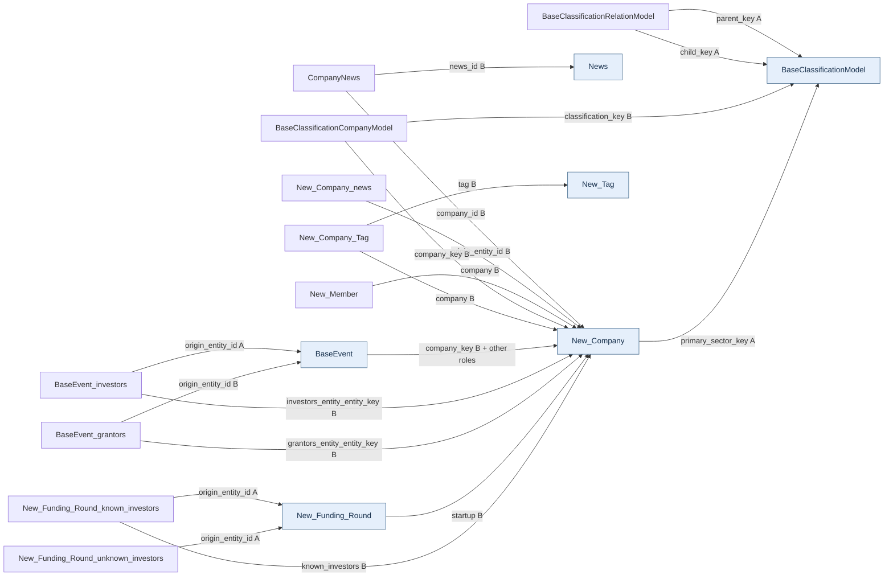

# Finder — ERD navigation

תרשים ניווט מצומצם לכל **16 טבלאות הליבה**. הקווים מציגים רק הפניות עיקריות שנבדקו; פירוט ה־31 צמדים, התנאים, ה־NULL והחריגות מופיע ב־[Relationship Matrix](relationships.md). תרשים Graphviz מלא בקובץ [Finder_ERD_Overview.dot](Finder_ERD_Overview.dot).

**A** = התאמה מלאה של הערכים שנבדקו; **B** = התאמה חלקית/חריגות/תחולה מוגבלת. שני הסיווגים **אינם אילוצים פיזיים**. בכל קשר כזה, כאשר ערך המקור מתאים ל־`id` ביעד, ההתאמה לכל היותר לרשומת יעד אחת (N:1).

הערות: `New_Company_news.news_id → News.news_id` **לא צויר** משום שמפתח היעד לא ייחודי. אין קו בין `BaseEvent` ל־`New_Funding_Round`. הפניות עצמיות (`New_Company.acquired_by_key`, `tto_key`, `r_d_due_to_acquisition_key`, `BaseClassificationModel.root_key`) והפניות תלויות־`event_type` מתועדות במטריצה ובתרשים DOT, ולא כולן מוצגות במפת הניווט כדי לשמור על קריאות.
